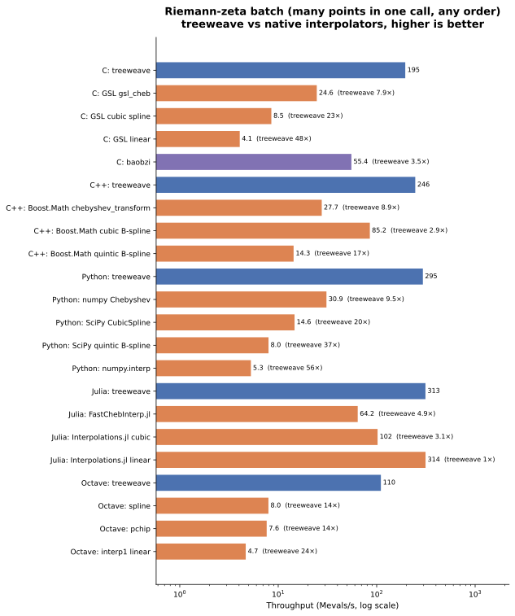

# Comparison with native interpolators

Most languages already have interpolators: Chebyshev series (numpy
`Chebyshev`, FastChebInterp.jl, Boost.Math, GSL), splines (SciPy, Boost.Math,
GSL, Interpolations.jl, `spline` and `pchip` in MATLAB/Octave) and linear lookup
tables (`numpy.interp`, `interp1`). This page compares treeweave with each of
them on one problem, at one accuracy. It also
compares treeweave with [baobzi](https://github.com/flatironinstitute/baobzi),
the library that inspired treeweave.

## The problem

The target is the Riemann zeta function as a fixed 160-term sum on `[2, 10]`:

$$\zeta(s) \approx \sum_{k=1}^{160} k^{-s}.$$

A direct sum costs up to 160 `pow` calls per point, about 1 Mevals/s in C++. A
code that calls it a million times per step spends its time in this sum. The
usual fix is to fit an interpolant once and evaluate the interpolant.

## The rules

- Every method fits the same function on the same interval.
- Every method grows until it meets
  `max|p - f| <= 1e-10 * max|f|`, the default criterion of treeweave
  (`RelativeMax`). Chebyshev methods grow the degree, splines and lookup
  tables double the number of uniform knots from 16, and Boost
  `chebyshev_transform` and baobzi tighten their own tolerance.
- The benchmark times each method only after the method meets the tolerance.
- All error values come from the same 4096 random points.
- baobzi gets the order (6 to 16) and tolerance that give its fastest batch.
- Each method uses its native call: a scalar call per point for "single",
  and one vectorized call for "batch" and "sorted batch".

## Results

One CI run of `benchmark-showcase.yml` on `ubuntu-24.04`, 2026-11-12
([run 43301633038](https://github.com/DiamonDinoia/treeweave/actions/runs/43301633038)).
The unit is Mevals/s (higher is better). The number in parentheses is the
treeweave throughput divided by the throughput of that method. The
[README](https://github.com/DiamonDinoia/treeweave#benchmarks) has the numbers
of the latest run.

| Language | Method | Size | Single | Batch | Sorted batch |
|---|---|---|---|---|---|
| C | treeweave | tol 1e-10 | 56.5 | 195 | 929 |
| C | GSL `gsl_cheb` | degree 26 | 24.7 (2.3×) | 24.6 (7.9×) | 24.7 (38×) |
| C | GSL cubic spline | 32768 knots | 8.5 (6.6×) | 8.5 (23×) | 89.4 (10×) |
| C | GSL linear | 524288 knots | 4.1 (14×) | 4.1 (48×) | 50.4 (18×) |
| C | baobzi | order 10, tol 1e-08 | 49.5 (1.1×) | 55.4 (3.5×) | 143 (6.5×) |
| C++ | treeweave | tol 1e-10 | 270 | 246 | 1,144 |
| C++ | Boost.Math `chebyshev_transform` | degree 27 | 27.2 (9.9×) | 27.7 (8.9×) | 34.6 (33×) |
| C++ | Boost.Math cubic B-spline | 1024 knots | 85.2 (3.2×) | 85.2 (2.9×) | 85.2 (13×) |
| C++ | Boost.Math quintic B-spline | 512 knots | 14.2 (19×) | 14.3 (17×) | 14.3 (80×) |
| Python | treeweave | tol 1e-10 | 1.2 | 295 | 1,654 |
| Python | numpy `Chebyshev` | degree 26 | 0.2 (6.8×) | 30.9 (9.5×) | 24.1 (69×) |
| Python | SciPy `CubicSpline` | 2048 knots | 0.2 (5.8×) | 14.6 (20×) | 172 (9.6×) |
| Python | SciPy `make_interp_spline(k=5)` | 512 knots | 0.3 (4.4×) | 8.0 (37×) | 14.6 (114×) |
| Python | `numpy.interp` | 524288 knots | 0.8 (1.4×) | 5.3 (56×) | 118 (14×) |
| Julia | treeweave | tol 1e-10 | 42.2 | 313 | 883 |
| Julia | FastChebInterp.jl | degree 26 | 57.4 (0.74×) | 64.2 (4.9×) | 65.1 (14×) |
| Julia | Interpolations.jl cubic | 32768 knots | 101 (0.42×) | 102 (3.1×) | 101 (8.7×) |
| Julia | Interpolations.jl linear | 524288 knots | 85.8 (0.49×) | 314 (1×) | 396 (2.2×) |
| Octave | treeweave | tol 1e-10 | 1e-03 | 110 | 214 |
| Octave | `spline` + `ppval` | 2048 knots | 4e-03 (0.39×) | 8.0 (14×) | 20.6 (10×) |
| Octave | `pchip` + `ppval` | 8192 knots | 3e-03 (0.5×) | 7.6 (14×) | 20.6 (10×) |
| Octave | `interp1` linear | 524288 knots | 2e-04 (8.8×) | 4.7 (24×) | 23.9 (9.0×) |



## Why treeweave is faster

A global Chebyshev series needs degree 26 or 27 to reach `1e-10` on this interval.
Each evaluation is a Clenshaw recurrence of 26 dependent steps. treeweave
splits the interval into leaves and fits a degree-7 polynomial on each leaf.
Each evaluation is a leaf lookup and 7 fused multiply-adds in Horner form.

Splines and lookup tables reach `1e-10` only with 512 to 524,288 knots. Each
evaluation first finds the interval of the point. GSL, `numpy.interp` and
`interp1` do a binary search over the knots. For an unsorted point in a
524,288-knot table, this search reads an array of 4 MiB, which is larger than
the L2 cache. Interpolations.jl calculates the interval from the uniform
spacing, without a search.

The batch call evaluates many points at once with SIMD. The sorted batch call
also skips the internal sort, so consecutive points stay in the same leaf. The
[performance guide](guides/performance.rst) gives the details.

## Where treeweave is not faster

- Single-point calls from Julia and Octave. Each call crosses a C binding,
  and this crossing costs more than the polynomial evaluation. The Julia
  interpolators are native Julia code, so the Julia compiler inlines them
  (0.42× to 0.74× in this run). Octave `spline` and `pchip` also evaluate one
  point faster than treeweave (0.39× and 0.5×). Use the batch call from these
  languages.
- Lookup tables in Julia. Interpolations.jl linear on 524,288 knots has the
  same batch throughput as treeweave (314 and 313 Mevals/s), because it does
  not search for the interval. On sorted batches treeweave is 2.2× faster.
- Error. The baselines stop below the tolerance (3.2e-12 to 8.3e-11 relative
  to `max|f|`, 4.5e-11 for baobzi), and treeweave stops at 9.8e-11 to 9.95e-11.
  All of them meet `1e-10`.
- One run per method after one warm-up, on a shared CI runner. Read the
  ratios to the nearest factor of two. The number of knots can change between
  runs, because the 4096 check points are random.

## Reproduce

Configure with `TREEWEAVE_BENCH_BASELINES=ON` to build the C and C++
baselines. This option needs Boost, FFTW, GSL and baobzi.

```bash
cmake -S . -B build/bench -G Ninja -DCMAKE_BUILD_TYPE=Release \
  -DTREEWEAVE_BUILD_TESTS=OFF -DTREEWEAVE_BUILD_BENCHMARKS=ON \
  -DTREEWEAVE_BENCH_BASELINES=ON -DCMAKE_PREFIX_PATH=/path/to/baobzi-install
cmake --build build/bench --target zeta_bench treeweave_c_zeta_bench
build/bench/zeta_bench
build/bench/treeweave_c_zeta_bench
```

The Python, Julia and Octave benchmarks are in
`bindings/python/benchmarks/zeta_bench.py`,
`bindings/julia/Treeweave/benchmarks/zeta_bench.jl` and
`bindings/matlab/benchmarks/zeta_bench.m`. The Python benchmark needs SciPy.
The Julia benchmark needs FastChebInterp.jl and Interpolations.jl. The workflow
`.github/workflows/benchmark-showcase.yml` runs all of them.
